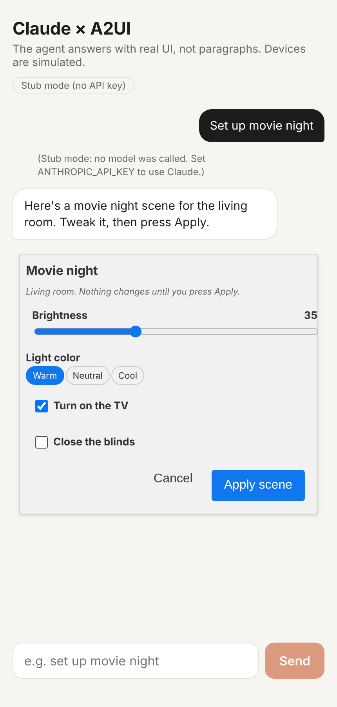
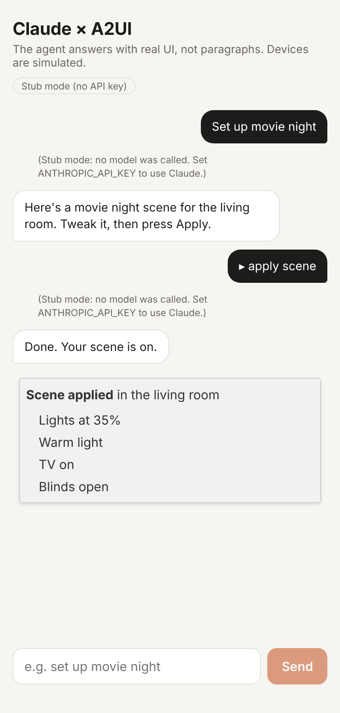

# Claude × A2UI starter

Claude answers with real UI instead of paragraphs.

A minimal, working example of [Google's A2UI 1.0](https://a2ui.org) with Claude:
a Node agent that streams validated A2UI messages, and a React app that renders them
with the official `@a2ui/react` renderer. The demo is a small smart-home agent: ask
for "movie night" and you get a card with a brightness slider, light color, TV and
blinds toggles, and an Apply button. Pressing Apply goes back to the agent as an action.

<p align="center">
  
  
</p>

## Run it

```bash
git clone https://github.com/Nurhak/a2ui-claude-starter.git
cd a2ui-claude-starter
npm install
npm run dev          # Node 22.9+ · agent on :8787, web app on http://localhost:5173
```

Without an API key it runs in **stub mode**: canned replies, written in A2UI exactly as
the model would write them, go through the same streaming parser and validation.
To use Claude:

```bash
cp .env.example .env   # then set ANTHROPIC_API_KEY
npm run dev
```

`MODEL` picks the Claude model (default `claude-sonnet-5-5`). `npm test` checks that
the canned replies pass the A2UI parser.

## How it works

```
browser (React)                      agent (Node)                          Claude
───────────────                      ────────────                          ──────
"set up movie night"  ── POST ──▶   system prompt + A2UI prompt snippet ─▶ streams text +
                                                                           <a2ui> … </a2ui>
surfaces render       ◀─ NDJSON ──  @a2ui/agent parses + validates   ◀──
press "Apply scene"   ── action ─▶  applyScene() runs in code, result
                                    goes to Claude, Claude confirms  ─▶ …
```

- **The agent never ships code to the browser.** Claude writes A2UI (the compact
  *Express* format), `@a2ui/agent` compiles and validates every message against the
  basic catalog while it streams, and only valid messages reach the page.
- **The page renders with its own components.** `@a2ui/react` + `MessageProcessor`
  from `@a2ui/web_core` turn the messages into a live surface with data bindings, so the
  slider and toggles update the surface's data model locally.
- **Actions are handled by code, not the model.** Button presses arrive as A2UI action
  messages. `server/home.ts` applies the scene, then the result is reported to Claude,
  which answers with a confirmation card.

| File | What it does |
| --- | --- |
| `server/index.ts` | Express agent: Claude streaming, A2UI parsing, action handling |
| `server/home.ts` | The simulated home. Replace `applyScene()` with Home Assistant, Hue, etc. |
| `server/stub.ts` | Canned replies for stub mode |
| `web/App.tsx` | Chat UI, `MessageProcessor`, `A2uiSurface`, action round-trip |

## Notes

- Built on `@a2ui/agent` 0.2, `@a2ui/react` / `@a2ui/web_core` 0.16 (protocol 1.0). The
  packages are still 0.x, so expect API changes.
- Devices are simulated. Nothing in this repo talks to real hardware.
- Conversations live in memory and reset when the agent restarts.

## License

MIT for this repo. The A2UI packages are Apache-2.0, © Google LLC.
